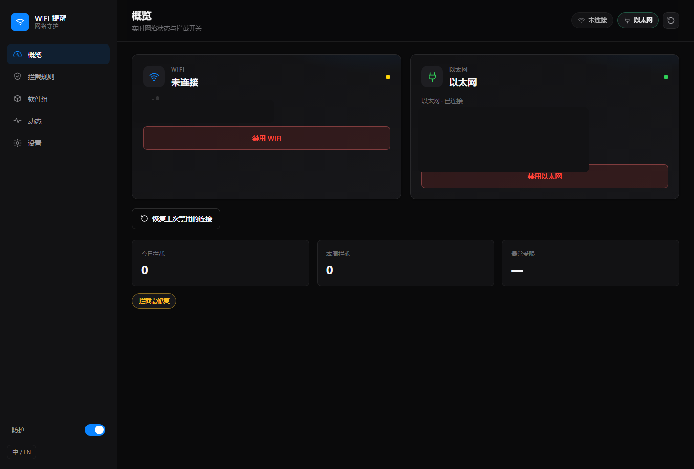
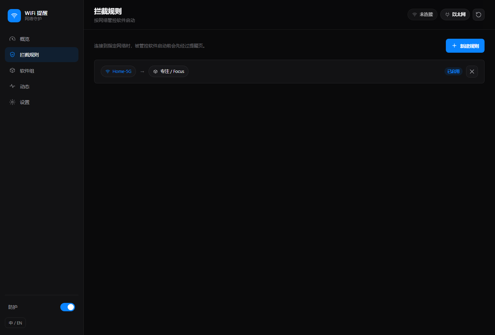
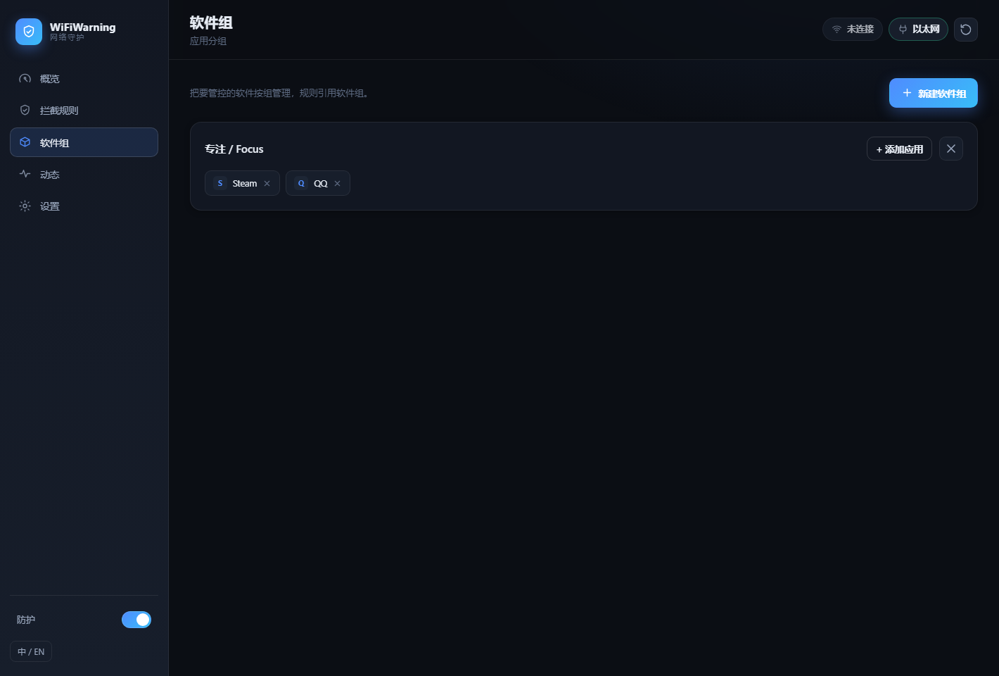
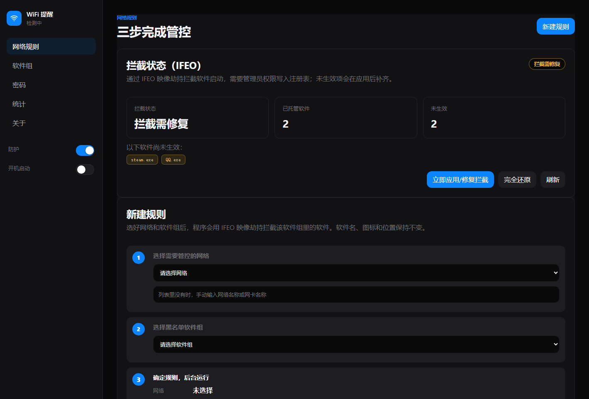

<div align="center">

# WiFi 提醒 · WiFi Warning

**按网络管控软件启动的 Windows 11 托盘工具 —— IFEO 级拦截，换网络、换启动方式都拦得住。**

[](https://www.microsoft.com/windows/windows-11)
[](https://en.cppreference.com/w/cpp/20)
[](LICENSE)
[](https://github.com/SSRYLJRSS/wifi-warning/releases)

Language: [简体中文](#zh-cn) · [English](#english)

</div>

## 界面预览

<p align="center">
  
  
</p>
<p align="center">
  
  
</p>
<p align="center"><sub>概览 · 拦截规则 · 软件组 · 拦截状态（示例数据，敏感信息已打码）</sub></p>

<a id="zh-cn"></a>

## 简体中文

WiFi 提醒是一款面向 Windows 11 的桌面托盘工具。你可以**按网络设置规则**：连接到指定的 WiFi 或以太网时，打开被管控的软件会先弹出提醒页，而不是直接启动。

它适合管住容易分心或需要被管控的软件（游戏、视频、聊天、代理等）。管控通过 **IFEO 映像劫持（Image File Execution Options）** 实现：系统在启动被管控的 exe 时会先经过本程序的启动守卫 `ww-launch.exe`，因此**无论从桌面、开始菜单、命令行、飘雪桌面/第三方启动器还是更新器启动，都会被拦截**，不再依赖快捷方式。

### v2.0 重构亮点

- **拦截机制重写为 IFEO，唯一机制**：删除容易失效的 .lnk 快捷方式替换方案，改为系统级映像劫持，拦截更可靠。
- **递归安全启动**：守卫用**同卷硬链接**（不支持的磁盘自动改为复制到可写目录）以另一个文件名启动真实程序，既不会再次命中 IFEO 造成死循环，也**不再用调试器方式**运行，兼容反作弊；透传退出码并支持 UAC 提权重入。
- **修复「定位服务常驻提示」**：不再持有常驻 WLAN 通知句柄，避免 Windows 持续显示“位置正在使用”。
- **实时监测** WiFi 与以太网，概览一屏看清当前网络与网卡；WiFi / 以太网均可一键禁用与恢复。
- 全新科技感界面（单页应用、深浅色主题、操作路径更短）。
- **C++20 + 原生 Win32 + 纯前端**，单进程常驻、占用低、运行稳定；仅适配 Windows 11。

> 构建（MSVC）：`scripts\build-msvc.bat`（VS2022 BuildTools + CMake + Ninja，产物在 `build\`）。

### 工作原理（为什么现在拦得住）

Windows 的 IFEO 允许为某个 exe 指定一个“调试器”。本程序把被管控 exe 的调试器指向 `ww-launch.exe`：

1. 系统准备启动被管控 exe 时，会先启动 `ww-launch.exe <目标exe> <原始参数...>`。
2. 守卫读取本地 `config.json`，判断当前网络是否命中规则：
   - **命中**：打开提醒页（或弹出提示），**不启动**目标程序 = 拦截。
   - **未命中 / 放行期 / 已关闭防护**：以“绕过 IFEO 递归”的方式启动真实程序。
3. 写入 IFEO 需要管理员权限，由随附的提权助手 `ww-admin.exe`（以管理员身份运行）完成；界面上的“立即应用/修复拦截”会触发一次 UAC。

> 说明：本程序为个人开发构建、**未做代码签名**。杀毒软件可能对“调试器启动 + 写 IFEO”这类行为敏感，请将整个程序目录加入杀毒软件白名单。所有还原操作都会精确恢复/删除对应的调试器键值，不会残留、也不会误删系统中其它 IFEO 项。

### 功能

- WiFi 与有线网络规则。
- 有线网络一键断开 / 一键恢复。
- 软件组管理：按 exe（`.exe`）选择要管控的软件。
- 提醒页支持切换安全 WiFi、断开有线网络、输入密码允许本次启动。
- 中英文界面切换。
- 绿色便携包：解压即用，无需 Node.js / Python / CMake 等开发环境。
- 本地运行：设置页仅监听 `localhost`，配置与日志保存在程序目录。

### 使用

1. 运行 `wifi-warning.exe`，程序常驻托盘并打开本地设置页（`http://localhost:18765/settings`）。
2. 在 **软件组** 里新建组并 **选择软件（.exe）**。
3. 在 **网络规则** 里选择要管控的网络（WiFi 或有线），绑定黑名单软件组。
4. 在 **拦截状态（IFEO）** 面板点 **立即应用 / 修复拦截**，在 UAC 提示中允许，使规则真正写入系统。
5. 连接匹配网络后，打开被管控软件会打开提醒页，可选择不启动、切换安全 WiFi、断开有线，或输入密码仅放行本次。

### 彻底还原（卸载前）

在设置页点 **完全还原**，或在程序目录运行：

```powershell
.\restore-interception.cmd
```

它会以管理员权限调用 `ww-admin.exe --ifeo-restore`，精确移除本程序写入的所有 IFEO 项并关闭防护。

### 从源码构建

环境：Windows 11、VS2022 BuildTools（含 C++ 工作负载）、CMake、Ninja（随 VS 附带即可）。

```powershell
.\scripts\build-msvc.bat
```

产物：`build\wifi-warning.exe`、`build\ww-launch.exe`、`build\ww-admin.exe`、`build\ww-smoke.exe`。

本地验收（需要 `build\` 中的 exe，前端目录放在运行目录以便静态资源命中）：

```powershell
.\build\ww-smoke.exe
```

### 项目结构

```text
src/core/        配置、日志、网络检测、规则、IFEO 管理（ifeo_manager）
src/ui/          本地 HTTP 服务、API、托盘图标
src/ww-launch/   IFEO 启动守卫（递归安全启动）
src/ww-admin/    提权助手（写入 / 还原 IFEO）
frontend/        设置页、提醒页、网络选择页
scripts/         构建、打包、smoke、验收脚本
tests/           原生 smoke test
docs/            设计与研究报告
```

### 许可证

本项目使用 [MIT License](LICENSE)。可自由使用、修改、二次开发与再发布；再发布时请保留原始版权与许可证声明。

返回语言切换：[English](#english)

<a id="english"></a>

## English

WiFi Warning is a Windows 11 desktop tray app. Create rules by network: when the PC is connected to a chosen WiFi or wired network, opening a managed app shows a warning page instead of launching it directly.

Management uses **IFEO (Image File Execution Options) image hijacking**: when Windows is about to start a managed .exe, it first launches this app's guard `ww-launch.exe`. So interception works no matter how the app is started — desktop, Start menu, CLI, third-party launchers (e.g. SnowDesktop) or updaters — and no longer depends on shortcuts.

### v2.0 rewrite highlights

- **Interception rewritten to IFEO as the only mechanism** — the fragile .lnk shortcut-replacement approach is gone.
- **Recursion-safe launch**: the guard relaunches the real app through a **same-volume hardlink** (falling back to copying into a writable folder when hardlinks are unavailable) under a different file name — so it neither re-triggers IFEO nor runs as a debuggee (anti-cheat friendly); exit codes propagate and UAC re-entry is supported.
- **Fixed the persistent "location in use" indicator** — no long-lived WLAN notification handle is kept.
- Real-time WiFi / Ethernet monitoring, one-click disable and restore.
- Fresh tech-style single-page UI with light/dark themes.
- **C++20 + native Win32 + plain web frontend**: single resident process, low footprint, stable; Windows 11 only.

> Note: this is a personal build and is **not code-signed**. Antivirus may flag "debugger launch + IFEO writes"; whitelist the app folder. All restore operations precisely restore/delete only the keys this app added.

### How it works

Windows IFEO lets you point an .exe at a "debugger". This app sets each managed exe's debugger to `ww-launch.exe`:

1. When Windows is about to start a managed exe, it first runs `ww-launch.exe <target.exe> <original args...>`.
2. The guard reads local `config.json` and checks the current network against rules:
   - **match**: open the warning page / show a prompt and **do not launch** = intercepted.
   - **no match / bypass window / protection off**: launch the real app in a recursion-safe way.
3. Writing IFEO requires administrator rights, done by the bundled elevated helper `ww-admin.exe` (a UAC prompt is shown when you click Apply/Repair).

### Features

- Rules for both WiFi and wired networks.
- One-click wired disconnect and restore.
- App groups managed by `.exe`.
- Warning page can switch to a safe WiFi, disconnect wired, or allow this launch with a password.
- Chinese / English UI.
- Portable: extract and run; no Node.js/Python/CMake needed.
- Local-first: settings listen on `localhost` only; config and logs stay in the app folder.

### Restore before uninstalling

Click **Restore all** in settings, or run in the app folder:

```powershell
.\restore-interception.cmd
```

It calls `ww-admin.exe --ifeo-restore` elevated to precisely remove every IFEO entry this app wrote and disable protection.

### Build from source

Requirements: Windows 11, VS2022 BuildTools (C++ workload), CMake, Ninja.

```powershell
.\scripts\build-msvc.bat
```

Outputs: `build\wifi-warning.exe`, `build\ww-launch.exe`, `build\ww-admin.exe`, `build\ww-smoke.exe`.

Run the smoke suite: `build\ww-smoke.exe`.

### License

MIT License. See [LICENSE](LICENSE).
